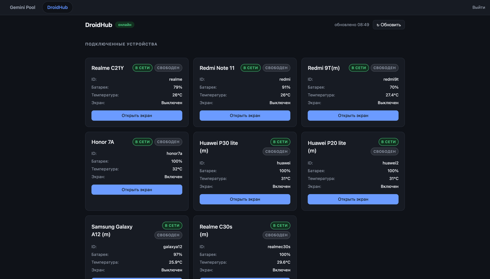

# 📱 DroidHub: Android-телефоны как инструмент для людей и ИИ-агентов


Сервер, который превращает обычные Android-телефоны на зарядке дома в удалённо управляемые устройства. Работать с ними можно тремя способами:

- **человек** управляет через веб-панель в браузере: видит экран в реальном времени, тапает, свайпает, вводит текст;
- **ИИ-агент** (Claude, Gemini) получает телефон как набор инструментов по протоколу **MCP**: «посмотреть экран», «нажать на элемент №5», «ввести текст»;
- **другие сервисы** работают через HTTP API. Например, бот [aviaticket](https://github.com/pazrabi/aviaticket) открывает сайты авиабилетов в мобильном Chrome с домашним IP и забирает JSON-ответы сайта через Chrome DevTools.

<p align="center">
  
</p>
<p align="center"><sub>Веб-панель: подключённые телефоны с зарядом, температурой и состоянием экрана, по кнопке открывается экран телефона.</sub></p>

## Что интересного с инженерной стороны

- **Экран для LLM в виде текста.** Инструмент `look` превращает дерево UI Android в компактный нумерованный список элементов («5. Кнопка „Войти“»). Агенту не нужно разбирать скриншот и считать координаты: он тапает по номеру, а это дешевле и надёжнее.
- **Ввод кириллицы и эмодзи** через ADBKeyBoard (base64-broadcast), потому что стандартный `adb input text` умеет только латиницу.
- **Чтение данных сайта из Chrome телефона** через CDP (`adb forward` к `chrome_devtools_remote`), в том числе потоковые задания с выдачей JSON-ответов по мере загрузки страницы.
- **Безопасность по умолчанию.** ADB доступен только внутри Tailscale. У каждого клиента свой токен, лимиты и права (например, `nopower` запрещает перезагрузку). Все действия пишутся в аудит. Shell в MCP отключён. Токены сравниваются за постоянное время, пароли хранятся в виде хэша scrypt, вход защищён от перебора.
- **Забота о железе.** Телефоны висят на зарядке круглосуточно, поэтому хаб следит за температурой и зарядом, шлёт тревоги в Telegram и при перегреве сам выключает устройство.
- **Единый вход (SSO)** для нескольких сервисов на одном домене: подписанный HMAC cookie и `forward_auth` в Caddy, с защитой от open redirect.
- **Деплой.** systemd-юнит с hardening (`ProtectSystem=strict`, `NoNewPrivileges`, `MemoryMax`), Caddy с автоматическим HTTPS, идемпотентный `install.sh` с режимом `--dry-run`.

**Стек:** Python 3.11+, asyncio, FastAPI, Uvicorn, MCP SDK (FastMCP, streamable HTTP), ADB, Chrome DevTools Protocol, SQLite, Jinja2 и vanilla JS без фреймворков, pytest.

---

## Архитектура

```
 [MacBook / любой браузер]      [Claude, Gemini pool]       [aviaticket бот]
            │ HTTPS                    │ MCP (HTTPS)               │ HTTP API / прокси
            └──────────────┬───────────┴───────────────────────────┘
                           ▼
              ┌─────────────────────────────┐
              │   Caddy (HTTPS, порт 443)   │
              │  hub.193-41-86-92.sslip.io  │
              └──────────────┬──────────────┘
                             │ reverse_proxy (127.0.0.1:8090)
                             ▼
              ┌─────────────────────────────┐
              │   DroidHub (FastAPI)       │
              │  systemd-сервис, user 'hub' │
              │  MemoryMax=600M, hardening  │
              └──────────────┬──────────────┘
                             │ Tailscale (приватная VPN-сеть)
                             │ ADB по TCP (порт 5555)
              ┌──────────────┴──────────────┐
              ▼                             ▼
       [Realme C21Y]                  [Redmi Note 11]
    дома, на зарядке, Wi-Fi        дома, на зарядке, Wi-Fi
```

- **Связь с телефонами**: исключительно внутри защищённой сети Tailscale (адреса `100.x.x.x`). Наружу порты телефонов не открываются.
- **Управление**: через протокол Android Debug Bridge (ADB) по TCP-порту 5555. Поддерживается ввод кириллицы через [ADBKeyBoard](https://github.com/senbox-org/ADBKeyBoard).
- **Стек**: Python 3.11+ / FastAPI / Uvicorn, SQLite аудит-лог, Caddy HTTPS reverse proxy, systemd с изолированным окружением.

---

## Быстрый старт

### 1. Локальный запуск (для разработки)

```bash
# Клонируйте репозиторий и перейдите в каталог
git clone https://github.com/pazrabi/droidhub.git
cd droidhub

# Создайте и активируйте виртуальное окружение Python
python3 -m venv venv
source venv/bin/activate

# Установите зависимости
pip install -r requirements.txt

# Настройте конфигурацию окружения
cp .env.example .env
# Сгенерируйте хэш пароля администратора:
python -m hub.auth hash
# Отредактируйте .env и укажите полученный хэш и секреты

# Запустите сервер разработки
uvicorn hub.main:create_app --factory --host 127.0.0.1 --port 8090

# Запуск тестов
python -m pytest -q
```

### 2. Деплой на боевой сервер (Ubuntu)

В репозитории подготовлены готовые скрипты и конфигурации в каталоге `deploy/`:

1. **Предпросмотр установки (dry-run)**:
   ```bash
   ./deploy/install.sh --dry-run
   ```
2. **Запуск установки**:
   ```bash
   sudo ./deploy/install.sh
   ```
   Скрипт установки идемпотентен:
   - создаёт системного пользователя `hub` и каталог `/opt/droidhub`;
   - разворачивает виртуальное окружение и ставит зависимости;
   - регистрирует и активирует systemd-сервис `/etc/systemd/system/droidhub.service`;
   - добавляет блок домена `hub.193-41-86-92.sslip.io` в `/etc/caddy/Caddyfile`, **не затрагивая** существующий блок gemini-pool;
   - **не перезаписывает** существующие `.env` и `devices.yaml`.

3. **Настройка секретов и запуск**:
   ```bash
   # Отредактируйте переменные окружения
   sudo nano /opt/droidhub/.env

   # Запустите сервис
   sudo systemctl start droidhub

   # Проверьте статус и логи
   sudo systemctl status droidhub
   sudo journalctl -u droidhub -f
   ```

---

## Как добавить телефон

Подробнейшая пошаговая инструкция для новичка (включая обход защиты Redmi и настройку без SIM-карты) находится в документе:  
👉 [**docs/phone-setup.md**](docs/phone-setup.md).

### Краткий чеклист:
1. Включите **«Режим разработчика»** на телефоне (7 тапов по номеру сборки / версии MIUI).
2. Включите **«Отладку по USB»** и отключите блокировку экрана.
3. *Для Redmi*: включите **«Отладку по USB (настройки безопасности)»** (см. инструкцию по обходу через временную SIM в docs).
4. Установите **Tailscale**, войдите в единый аккаунт и включите **«Постоянный VPN»**.
5. Подключите телефон кабелем к компьютеру и включите сетевую отладку:
   ```bash
   adb tcpip 5555
   ```
6. Установите клавиатуру **ADBKeyBoard** для поддержки кириллицы:
   ```bash
   adb install ADBKeyBoard.apk
   adb shell ime enable com.android.adbkeyboard/.AdbIME
   adb shell ime set com.android.adbkeyboard/.AdbIME
   ```
7. Добавьте телефон в файл конфигурации `config/devices.yaml` (или `/opt/droidhub/config/devices.yaml` на сервере):
   ```yaml
   devices:
     - id: redmi
       name: Redmi Note 11
       host: 100.64.0.2
       port: 5555
     - id: realme
       name: Realme C21Y
       host: 100.64.0.1
       port: 5555
   ```

---

## Подключение MCP

DroidHub предоставляет сервер стандартного протокола **Model Context Protocol (MCP)** (FastMCP, streamable HTTP) для прямого управления смартфонами нейросетями (Claude Code, claude.ai, Claude Desktop, Gemini pool).

### Авторизация
Поддерживается два способа авторизации:
1. **Заголовок Authorization**: `Authorization: Bearer <HUB_MCP_TOKEN>`
2. **Секретный путь URL**: `https://<домен>/mcp/<HUB_MCP_TOKEN>` (удобно для клиентов и коннекторов, не поддерживающих кастомные HTTP-заголовки).

Сравнение токенов производится за постоянное время через `hmac.compare_digest`.  
> **Безопасность**: если переменная `HUB_MCP_TOKEN` в `.env` пустая или не задана, MCP-сервер полностью отключён (любой запрос возвращает `503 Service Unavailable`).

### 1. Claude Code (CLI)
Для подключения к Claude Code используйте официальную команду с параметром `--transport http`:

**С заголовком Authorization:**
```bash
claude mcp add --transport http droidhub https://hub.193-41-86-92.sslip.io/mcp -H "Authorization: Bearer <HUB_MCP_TOKEN>"
```

**С секретным путем в URL:**
```bash
claude mcp add --transport http droidhub https://hub.193-41-86-92.sslip.io/mcp/<HUB_MCP_TOKEN>
```

Для локальной разработки:
```bash
claude mcp add --transport http droidhub http://127.0.0.1:8090/mcp -H "Authorization: Bearer <HUB_MCP_TOKEN>"
```

### 2. Коннектор claude.ai (веб)
В веб-версии [claude.ai](https://claude.ai) (в настройках Connectors / Custom MCP Server):
- **Name**: `DroidHub`
- **URL**: `https://hub.193-41-86-92.sslip.io/mcp` (укажите заголовок `Authorization: Bearer <HUB_MCP_TOKEN>`)  
  ИЛИ укажите секретный путь: `https://hub.193-41-86-92.sslip.io/mcp/<HUB_MCP_TOKEN>`

### 3. Claude Desktop
В файле `~/Library/Application Support/Claude/claude_desktop_config.json` (macOS):
```json
{
  "mcpServers": {
    "droidhub": {
      "url": "https://hub.193-41-86-92.sslip.io/mcp",
      "headers": {
        "Authorization": "Bearer <HUB_MCP_TOKEN>"
      }
    }
  }
}
```
Или через секретный путь:
```json
{
  "mcpServers": {
    "droidhub": {
      "url": "https://hub.193-41-86-92.sslip.io/mcp/<HUB_MCP_TOKEN>"
    }
  }
}
```

### Доступные инструменты MCP
Каждый инструмент принимает обязательный идентификатор устройства `device_id` (например, `"realme"`, `"redmi"`). Для надежной работы ИИ-агента рекомендуется сначала проанализировать экран (`ui_dump` или `screenshot`), а затем выполнять действия (все координаты указываются в пикселях экрана).

- `list_devices()` — список подключенных телефонов и их текущие статусы (онлайн, батарея, температура, экран).
- `device_status(device_id)` — детальный статус устройства (заряд %, температура °C, включен ли экран).
- `screenshot(device_id, max_width=720)` — снимок экрана устройства в формате JPEG (возвращает картинку).
- `ui_dump(device_id)` — дамп дерева элементов интерфейса (тексты, resource_id, границы bounds и центры элементов в пикселях). Рекомендуется вызывать перед тапом.
- `tap(device_id, x, y)` — нажатие по экрану в пиксельных координатах.
- `tap_element(device_id, text=None, resource_id=None)` — поиск элемента по тексту или resource_id и нажатие на его центр.
- `swipe(device_id, x1, y1, x2, y2, ms=300)` — свайп между точками в пикселях.
- `type_text(device_id, text)` — ввод любого текста (латиница, кириллица, спецсимволы, эмодзи).
- `press_key(device_id, key)` — нажатие системных клавиш (`back`, `home`, `recents`, `enter`, `power`, `volume_up`, `volume_down`).
- `open_app(device_id, package)` — запуск приложения по пакету (например, `com.android.chrome`).
- `list_apps(device_id)` — список установленных приложений.
- `open_url(device_id, url)` — открытие ссылки в мобильном браузере.
- `wait(device_id, seconds=1.0)` — пауза для ожидания прогрузки интерфейса или завершения анимаций.

*Произвольное выполнение команд shell в MCP не регистрируется в целях безопасности.*  
Все вызовы инструментов фиксируются в журнале аудита с пометкой `actor="mcp"`, а частота действий защищена общим лимитом `rate_limit_per_min`.

---

## Безопасность

- **Изоляция сети**: приложение слушает только интерфейс `127.0.0.1:8090`. Доступ снаружи открыт только через Caddy по HTTPS.
- **Приватный ADB**: телефоны не доступны из публичного интернета, связь с ними осуществляется строго по зашифрованному туннелю Tailscale.
- **Хранение секретов**: все пароли, хэши и токены хранятся в `.env` (файл защищён правами `0600` и исключён из Git).
- **Hardening сервиса**: systemd-юнит запускается под отдельным пользователем `hub`, с ограничениями `MemoryMax=600M`, `ProtectSystem=strict`, `NoNewPrivileges=true`, `PrivateTmp=true` и полным сбросом Linux capabilities.
- **Аудит действий**: каждая операция (тап, скриншот, запуск приложения) с именем инициатора (пользователь веб-панели или API/MCP-клиент) протоколируется в SQLite-базе `data/hub.db`.
- **Защита от перегрузки**: лимит действий на устройство (`rate_limit_per_min`) и защита от перебора паролей на странице входа.

---

## Структура репозитория

```
droidhub/
├── config/
│   └── devices.yaml          # Список подключённых устройств
├── data/                     # SQLite-база аудита (hub.db)
├── deploy/
│   ├── droidhub.service     # Systemd-юнит с харденингом и MemoryMax=600M
│   ├── Caddyfile.snippet     # Блок reverse_proxy для Caddy
│   └── install.sh            # Идемпотентный скрипт установки (--dry-run)
├── docs/
│   └── phone-setup.md        # Пошаговая инструкция по настройке телефонов
├── hub/
│   ├── main.py               # Точка входа FastAPI приложения
│   ├── config.py             # Настройки из .env и devices.yaml
│   ├── auth/                 # Авторизация: passwords, limiter, clients, guards, routes, cli
│   ├── audit.py              # Журнал аудита действий
│   ├── alerts.py             # Оповещения Telegram, автовыключение при перегреве
│   ├── sso.py, sso_routes.py # Единый вход molokohub (cookie, /sso/*)
│   ├── cli.py                # Вспомогательный CLI для проверки
│   ├── mcp_server/           # MCP: tools (инструменты), look, auth, ratelimit, context, app
│   ├── web/                  # Страницы (views.py), шаблоны, static: style.css, app.js, js/*.js
│   ├── devices/
│   │   ├── adb.py            # Обёртка над ADB через asyncio subprocess
│   │   ├── manager.py        # Менеджер устройств и мониторинг
│   │   └── actions.py        # Действия (тап, ввод, свайп, скриншот)
│   └── api/                  # REST API роутеры
├── tests/                    # Набор юнит- и интеграционных тестов
├── requirements.txt          # Зависимости Python
├── .env.example              # Пример переменных окружения
└── README.md
```
